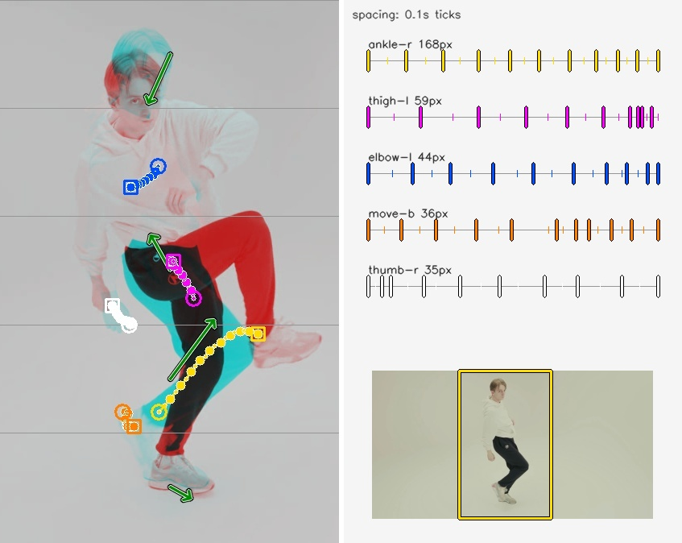
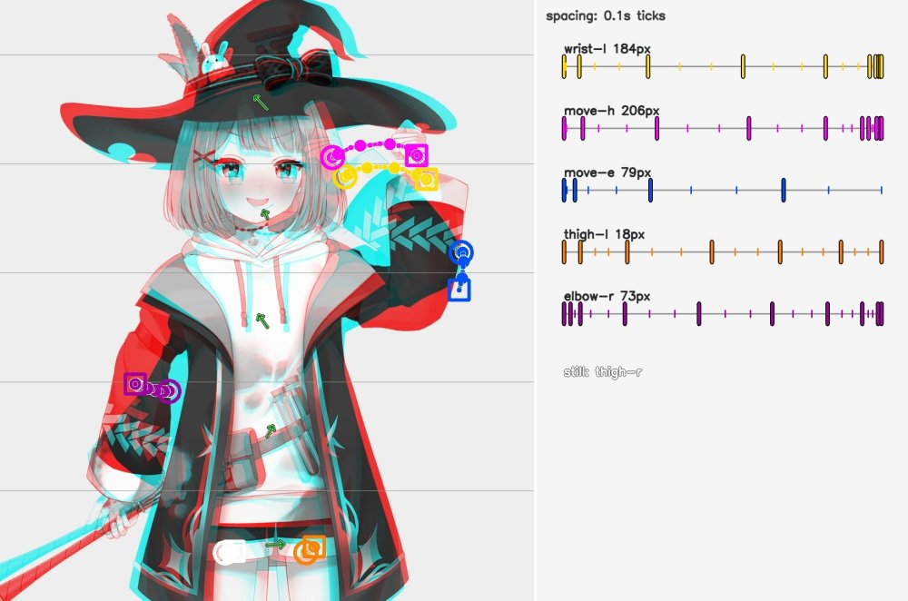

<p align="center"><a href="../README.md">한국어</a> · <b>English</b> · <a href="README.ja.md">日本語</a></p>

<p align="center">
  <picture>
    <source media="(prefers-color-scheme: dark)" srcset="../assets/banner-dark.svg">
    
  </picture>
</p>

# LLM Video Lens

A command-line tool that turns video into short text and check images an AI (LLM) can read. It splits the video into shots, writes down how the body and the camera moved in each one, and keeps everything traceable to original frame numbers.
## Why

AI agents see a video as a handful of still frames. They cannot see what moved between one frame and the next, how far or how, so the direction and size of a motion are hard for them to grasp. Easing, such as a fast start that slows to a stop, is especially hard. That makes tasks like "analyse the easing in this reference video and animate with the same feel" very difficult.

LLM Video Lens is a helper for that. It follows the motion between frames with tracked points, writes down direction, distance and change of speed, and draws the trails over the picture, so an agent can read the motion that a few frames miss.

Give it one video with people or characters in it, and for each shot (cut) it writes the movement of the body, arms, legs and camera as short text (`look.md`) and makes pictures to check it against. It does not make up what it isn't sure of: spans where points were lost are written as unknown, and spans where the estimate wavers are gathered under "먼저 확인할 곳" (check first) at the top.

## Features

- **One-command summary (`look`)**: analyses a video into a per-shot motion summary (`look.md`, written in Korean) and pictures to check it against.
- **Ask about one span (`at`)**: gathers only the evidence for a span of up to 4 s, for questions like "what happens at 18–22 s?".
- **Shots and a shot list (`scan`, `brief`, `catalog`)**: finds cut boundaries and lists each shot with its original frame range and any missing coverage.
- **Compare frames (`compare`, `zoom`)**: shows the difference between two frames as a picture, or a short span as dense frames.
- **Place your own points (`grid`, `mark`)**: place, name and track points on props or parts the pose model has no name for.
- **Stays inside the workspace**: it reads videos and writes results only in the workspace folder you give it.

## Quick start

1. With Python 3.11 or later, install the dependencies (checked on macOS Apple Silicon with Python 3.12). `look` uses both pose estimation and point tracking, so it needs both sets.

   ```sh
   pip install -r requirements/pose.txt -r requirements/tracking.txt
   ```

2. Get the three model files yourself: person detection (YOLOX HumanArt, ONNX), whole-body pose (RTMW 133 keypoints, ONNX) and point tracking (a CoTracker checkpoint). They are not in the repository and are never downloaded for you. Person detection can be switched to DeepGHS for drawn figures or to the SAM3 bundle ([Models and licenses](#models-and-licenses), [detector choice and pinned files](person-detectors.md)).
3. Copy the video into the workspace folder (by default `workspace/` in the repository), and write the model paths in `workspace/models.json`.

   ```json
   {"detector": "/models/yolox_humanart.onnx", "pose_model": "/models/rtmw133.onnx", "checkpoint": "/models/scaled_offline.pth"}
   ```

4. Run it from the repository folder. `W` below is the path of the workspace folder. The package and command keep the original name, `image_lens`.

   ```sh
   python -m image_lens --workspace W look --video clip.mp4 --out look-clip
   ```

5. Open `look.md` in the output folder. Start with "먼저 확인할 곳" at the top.

## Examples

### Summarize a video and read it

`look.md` sums up each tracked span in one line, and each line holds:

- the shot framing: full body, knees up, upper body, face close-up
- how the whole frame (camera) and the body centre moved
- how parts such as arms and legs moved relative to the body, with speeds, e.g. "속도 9→5→3→1 px/f"
- warnings such as lost points, a sudden change of drawing and repeated poses

It also makes pictures:

- `…-onion.jpg`: an onion skin for each span: the first and last frames overlaid, with the movement drawn as trails and arrows
- `frame-sheet-N.jpg`: frames picked evenly from the whole video
- `check-sheet-N.jpg`: dense frames of each "먼저 확인할 곳" span

### Example results

#### Live action

One line from the `look.md` of a live-action solo dance video, the span where the dancer lifts a knee (shortened with `…`). The output text is Korean.

```text
- 15.44–16.32s f386..407 | 전신 | 정면(사람 왼쪽=화면 오른쪽) | 팔 자세: 왼팔 가슴 높이·오른팔 허리 아래 그대로 | 전체: 카메라 모름(5%만 맞춤), 몸 왼쪽 아래 33px(속도 2.5→2.2→1.6→1.4→0.8 px/f) | 몸 기준: 오른다리(화면 왼쪽: 발목·무릎·허벅지) 오른쪽 위 147px(속도 13.3→13.3→12.2→10.4→10.2 px/f, 앞선 동작은 모름) → 오른쪽 51px(속도 9.2→7.3→5.8→6 px/f), 몸 바깥으로; 왼다리(화면 오른쪽: 허벅지·발목·무릎) 위 74px(…), 몸 쪽으로; … | 높이별(화면 좌표, 카메라 모름): 왼쪽 아래 33 / ? / 왼쪽 위 25 / 오른쪽 위 45 / 오른쪽 아래 14 (…) | 몸 돌림 후보(어깨 폭 크게 변함, 포즈가 튄 것일 수도; 그동안 어깨 높이는 안 씀): 15.44–15.88s | …
```

- `15.44–16.32s f386..407`: time and source frame numbers, to trace back to the video.
- `전신` (full body), `정면(사람 왼쪽=화면 오른쪽)` (facing the camera, person's left = screen right): framing and facing. Left and right after this are the person's own; the brackets give the screen side.
- `팔 자세` (arm posture): wrist height at the start and end of the span; here it stays the same (`그대로`).
- `전체` (whole): camera and body-centre movement. The background is plain, so the camera is unknown (`모름`); the body centre went 33 px down-left. Speeds that get smaller mean it slowed down.
- `몸 기준` (relative to the body): limb movement with the body centre removed, arrows in time order. The right leg went 147 px up-right, then 51 px further right: the knee lift.
- `높이별` (by height): movement measured in 5 bands from top to bottom of the area where the person is; `?` means that band could not be measured.
- `몸 돌림 후보` (turn candidate): a place marked for checking because the estimate wavered.

<p align="center"></p>

The onion skin of the same span. The left panel overlays the start (cyan) and the end (red). The dotted trails are the parts in the order `몸 기준` lists them: yellow (right leg), magenta (left leg), blue (left arm)… One dot is one frame; a slightly bigger dot marks every 0.1 s, so where those get closer the part slowed down. A circle is the start, a square the end. Green arrows are the `높이별` movement. The right panel is a spacing chart: each part's path stretched to one equal-length line, with a thick tick every 0.1 s. Close ticks mean slow, wide ticks fast, so the ease of a small move reads here too. The small picture under the chart is the whole first frame of the span, with the part the onion shows outlined in yellow.

The tool was also confused in this example: the shoulder width changed as the leg came up, so a turn candidate was marked although the body did not turn. The left arm's speed also came out unknown.

Video: Antoni Shkraba, ["Video of a Man Dancing"](https://www.pexels.com/video/video-of-a-man-dancing-7571381/), Pexels ([Pexels License](https://www.pexels.com/license/)). Seconds 0–20, scaled to 1280×674, then run through `look`.

#### Animation

<p align="center"></p>

2D illustrated and animated characters read the same way. In this 1.5 s move the hand at the hat brim sweeps outward while the head tilts; its easing follows the speed changes this tool measured in another reference video. The two fingertip points (magenta, yellow) draw side-by-side arcs, and the hat and face outlines split as far as the head tilted. `몸 기준` says the left arm went right 124 px fast, then 68 px more while slowing. The background is plain, so the camera is "모름" (unknown).

Model: Live2D Inc. sample model "Mao", used under the [Live2D Free Material License Agreement](https://www.live2d.com/eula/live2d-free-material-license-agreement_en.html). The picture is `look` run on a 1.5 s clip animated with the Live2D Cubism SDK for Web; the model files and the clip are not in the repository.
This content uses sample data owned and copyrighted by Live2D Inc.

### Ask about one span

When the summary is not enough, you can look at just the span you are curious about (4 s at most) in more detail.

```bash
python -m image_lens --workspace W at --look W/look-clip --span 18-22 --out W/at-18-22
```

`at.md` gathers the lines and notes that overlap the span and names the pictures to open; `at-frames-1.jpg` holds 12 dense frames.

### Track parts the pose model doesn't know

Look at a frame with a coordinate grid drawn by `grid`, then place and track points with `mark`. You can place up to 8 points, named in ASCII.

Place points on a corner where two outlines meet, or on a small spot (an eye, a button). A point mid-way along a straight edge or on a flat fill misses motion along that edge. In the result picture (`mark-onion.jpg`), if the start and end outlines are far apart but the dotted trail is short, the tracking slipped on the way. Move that point to a clear corner and try again.

```bash
python -m image_lens --workspace W grid --video V --frame 572 --box 100,250,1000,1000 --out W/grid-f572.jpg
python -m image_lens --workspace W mark --video V --shots W/look/shots.json --frame 572 --end 599 --point hammer-stripe=430,680 --point eye=322,738 --checkpoint C --out W/mark-s19
```

If look followed the wrong person, or you want something that is not a person, give `box` a box. The green outline on the small frame under the onion chart is the person look tracked. When the box covers a person, that person's joints are tracked; otherwise up to 8 clear corners inside the box, the same way as `mark`.

```bash
python -m image_lens --workspace W box --video V --look W/look --frame 0 --end 119 --box 0,300,880,1440 --checkpoint C --out W/box-f0
```

If the box is on the right person but badly shaped (head cut off, screen UI inside), re-run only that window with another person detector. `redo` leaves the first look as it is and looks at that window's frames again in a new look folder. `redo-boxes.jpg` draws the first (red) and the new (green) boxes on the same frames. The window name is the start of its file names (`shot-0000-w0`). The SAM3 bundle is slow on a whole video (about 15 min for a 39 s clip) but short on one window (30 frames in 33 s).

```bash
python -m image_lens --workspace W redo --look W/look --window shot-0000-w0 --detector /models/sam3-bundle --out W/redo-w0 --checkpoint C
```

## Status and limits

- Limb positions are estimated from the pose model and point tracking together; where they are unsure, the line says "모름" (unknown). Comparisons and limits are in the [look notes](look-notes.md).
- It was checked on macOS arm64 with Python 3.12. Windows and installed wheels are unverified, and point tracking needs a POSIX system.
- Pose, action, telling people apart and easing are not guaranteed to be accurate. Spans not under "먼저 확인할 곳" can be wrong too, so read the frame sheets as well.
- You supply the model files. The CoTracker source and checkpoint carry noncommercial terms, and the pose model weights' licenses are unchecked.
- Videos larger than 1920×1080 are scaled down first; px values in the reports are then for the scaled video.

## Built with AI

A person set the direction and AI agents built this project together. What to build, which accuracy to aim for and what to adopt were human decisions; implementation, measurement and code review were split between Claude (Anthropic) and Codex (OpenAI) agents. The [look notes](look-notes.md) are the agents' measurement log.

## Models and licenses

| Part | Used for | License |
|---|---|---|
| YOLOX HumanArt (ONNX, bring your own) | person detection (default) | weight license not established |
| [DeepGHS anime_person_detection](https://huggingface.co/deepghs/anime_person_detection) (ONNX, bring your own) | person detection for drawn figures (optional) | MIT |
| [SAM3](https://huggingface.co/mlx-community/sam3-image) MLX weights (bring your own) and `image_lens/_sam3_mlx` (included) | person detection (optional, Apple Silicon) | Meta SAM License |
| RTMW-l 384, 133 keypoints (ONNX, bring your own) | whole-body pose | weight license not established |
| [CoTracker](https://github.com/facebookresearch/co-tracker) (source in `image_lens/vendor/source`, checkpoint bring your own) | point tracking | CC-BY-NC 4.0 |
| [PySceneDetect](https://www.scenedetect.com/) (in `image_lens/vendor/shot-detector`) | finding cuts | BSD 3-Clause |
| rtmlib detector postprocess (`pose.py`) · ONNX Runtime · MLX | running the models | Apache-2.0 · MIT · MIT |

- The project's own code and documents are [MIT](../LICENSE). Vendored code keeps its own terms.
- CoTracker source and checkpoint are for noncommercial use only. SAM3 follows the SAM License; research that uses it must acknowledge SAM3.
- No model weights are in the repository. The SAM3 upload (mlx-community) says apache-2.0, but the weights follow the original's (facebook/sam3) SAM License.

## More

- [Full guide](guide.md): every command and option, the full way to read `look.md`, output files, the brief format, jobs and tracking, pose seeds
- [LAN API](../lan/README.md): a server and client for running this Mac's `look` and `at` from another PC on the home LAN
- [look notes](look-notes.md): `look`'s limits and the checks behind them
- [Limitations](limitations.md) · [Verification](verification.md) · [Provenance and licenses](provenance.md) · [Job contract](jobs.md)
- Run the tests: `python -B -m unittest discover -s tests -v`
