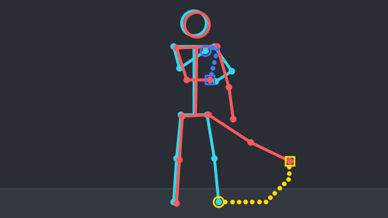

<p align="center"><a href="../README.md">한국어</a> · <b>English</b> · <a href="README.ja.md">日本語</a></p>

<p align="center">
  <picture>
    <source media="(prefers-color-scheme: dark)" srcset="../assets/banner-dark.svg">
    
  </picture>
</p>

# LLM Video Lens

A command-line tool that turns video into short text and check images an AI (LLM) can read. It splits the video into shots, writes down how the body and the camera moved in each one, and keeps everything traceable to original frame numbers.

The package, command and LAN service keep the original name, `image_lens` (`image-lens`).

## What is it?

It prepares videos with people or characters in them so that an AI agent can work with them. Give it one video, and for each shot (cut) it writes the movement of the body, arms, legs and camera as short text (`look.md`) and makes pictures to check it against. People can open and read the same output files.

It does not make up what it isn't sure of. Spans where points were lost are written as unknown, and spans the tool itself doubts are gathered under "먼저 확인할 곳" (check first) at the top.

## Features

- **One-command summary (`look`)**: turns a video into a per-shot motion summary, `look.md`, plus pictures. The output text is in Korean.
- **Ask about one span (`at`)**: gathers only the evidence for a span of up to 4 s, for questions like "what happens at 18–22 s?".
- **Shots and a shot list (`scan`, `brief`, `catalog`)**: finds cut boundaries and lists each shot with its original frame range and any missing coverage.
- **Compare frames (`compare`, `zoom`)**: shows the difference between two frames as a picture, or a short span as dense frames.
- **Place your own points (`grid`, `mark`)**: place, name and track points on props or parts the pose model has no name for.
- **Closed workspace**: inputs and outputs are read and written only inside the workspace folder. Overwrites and paths through symbolic links are refused.

## Quick start

1. With Python 3.11 or later, install the dependencies. `look` uses both pose estimation and point tracking, so it needs both sets.

   ```sh
   pip install -r requirements/pose.txt -r requirements/tracking.txt
   ```

2. Get the three model files yourself: person detection (YOLOX HumanArt, ONNX), whole-body pose (RTMW 133 keypoints, ONNX) and point tracking (a CoTracker checkpoint). They are not in the repository and are never downloaded for you.
3. Copy the video into the workspace folder (by default `workspace/` in the repository), and write the model paths in `workspace/models.json`.

   ```json
   {"detector": "/models/yolox_humanart.onnx", "pose_model": "/models/rtmw133.onnx", "checkpoint": "/models/scaled_offline.pth"}
   ```

4. Run it from the repository folder. `W` below is the path of the workspace folder.

   ```sh
   python -m image_lens --workspace W look --video clip.mp4 --out look-clip
   ```

5. Open `look.md` in the output folder. Start with "먼저 확인할 곳" at the top.

## Examples

### Summarize a video and read it

`look.md` has one line per tracked span. Each line has:

- the shot framing: full body, knees up, upper body, face close-up
- how the whole frame (camera) and the body centre moved
- how parts such as arms and legs moved relative to the body, with speeds, e.g. "속도 9→5→3→1 px/f"
- reading notes such as lost points, drawing changes and repeated poses

It also makes pictures:

- `<window>-onion.jpg`: the first and last frames overlaid, with the movement drawn as arrows
- `frame-sheet-N.jpg`: frames picked evenly from the whole video
- `check-sheet-N.jpg`: dense frames of each "먼저 확인할 곳" span

### Reading one line

One line from the `look.md` of a live-action solo dance video (shortened with `…`). The output text is Korean.

```text
- 2.16–3.40s f54..84 | 전신 | 정면(사람 왼쪽=화면 오른쪽) | 팔 자세: 왼팔 가슴 높이·오른팔 어깨 높이, 오른팔 몸 가운데 넘어감 → 왼팔 허리 아래·오른팔 가슴 높이, 오른팔 몸 가운데 넘어감 | 전체: 카메라 모름(3%만 맞춤), 몸 관측 끊김·기준점 변경, 전체 이동 모름 | 몸 기준: 왼다리(화면 오른쪽: 발목·무릎·허벅지) 오른쪽 65px → 오른쪽 위 44px → 위 27px, 몸 바깥으로; … | 손-몸: 두 손 모음 2.24–3.16s, 떨어짐; 오른손(화면 왼쪽)이 왼어깨(화면 오른쪽) 가까이 옴 2.40–3.08s, 떨어짐 | …
```

- `2.16–3.40s f54..84`: time and source frame numbers, to trace back to the video.
- `전신` (full body), `정면(사람 왼쪽=화면 오른쪽)` (facing the camera, person's left = screen right): framing and facing. Left and right after this are the person's own; the brackets give the screen side.
- `팔 자세` (arm posture): wrist height at the start and end of the span, and whether a wrist crossed the body's midline.
- `전체` (whole): camera and body-centre movement. This video has a plain background, so the camera cannot be measured and is written as unknown (`모름`).
- `몸 기준` (relative to the body): limb movement with the body centre removed, arrows in time order. Here the left leg goes out to the right, then up.
- `손-몸` (hand-body): a hand near the other shoulder, or the two hands together. It is a distance on the screen, so read it as a touch candidate.

<p align="center"></p>

The picture is drawn to explain this line; it is not a video frame. Real onion pictures are drawn the same way on top of the video frames: cyan is the start, red the end, and the dotted trails are the parts in the order `몸 기준` lists them, yellow, magenta, blue… (one dot per frame, circle at the start, square at the end).

### Ask about one span

Instead of rereading the whole summary, ask about that span. Spans are 4 s at most.

```bash
python -m image_lens --workspace W at --look W/look-clip --span 18-22 --out W/at-18-22
```

`at.md` gathers the lines and notes that overlap the span and names the pictures to open; `at-frames-1.jpg` holds 12 dense frames.

### Track parts the pose model doesn't know

Look at a frame with a coordinate grid drawn by `grid`, then place and track points with `mark`. You can place up to 8 points, named in ASCII.

```bash
python -m image_lens --workspace W grid --video V --frame 572 --box 100,250,1000,1000 --out W/grid-f572.jpg
python -m image_lens --workspace W mark --video V --shots W/look/shots.json --frame 572 --end 599 --point hammer-stripe=430,680 --point eye=322,738 --checkpoint C --out W/mark-s19
```

## Status and limits

- It was checked on macOS arm64 with Python 3.12. Windows and installed wheels are unverified, and point tracking needs a POSIX system.
- No accuracy is claimed for pose, action, telling people apart, or easing. Spans not under "먼저 확인할 곳" can be wrong too, so read the frame sheets as well.
- You supply the model files. The CoTracker source and checkpoint carry noncommercial terms, and the pose model weights' licenses are unchecked.
- Videos larger than 1920×1080 are scaled down first; px values in the reports are then for the scaled video.

## Built with AI

A person set the direction and AI agents built this project together. What to build, which accuracy to aim for and what to adopt were human decisions; implementation, measurement and code review were split between Claude (Anthropic) and Codex (OpenAI) agents. Recent changes were accepted only after a different agent scored them on held-out labelled frames the author could not see. The banner shows the same idea: Claude reads the film strip and writes one line at a time into BRIEF. The [look notes](look-notes.md) are the agents' measurement log.

## License

The project's own code and documents are [MIT](../LICENSE). Vendored code keeps its own terms: `image_lens/vendor/shot-detector` (PySceneDetect) is BSD 3-Clause, and `image_lens/vendor/source` (CoTracker) is CC-BY-NC 4.0, noncommercial use only. No model weights are included.

## More

- [Full guide](guide.md): every command and option, the full way to read `look.md`, output files, the brief format, jobs and tracking, pose seeds
- [LAN API](../lan/README.md): a server and client for running this Mac's `look` and `at` from another PC on the home LAN
- [look notes](look-notes.md): `look`'s limits and the checks behind them
- [Limitations](limitations.md) · [Verification](verification.md) · [Provenance and licenses](provenance.md) · [Job contract](jobs.md)
- Run the tests: `python -B -m unittest discover -s tests -v`
